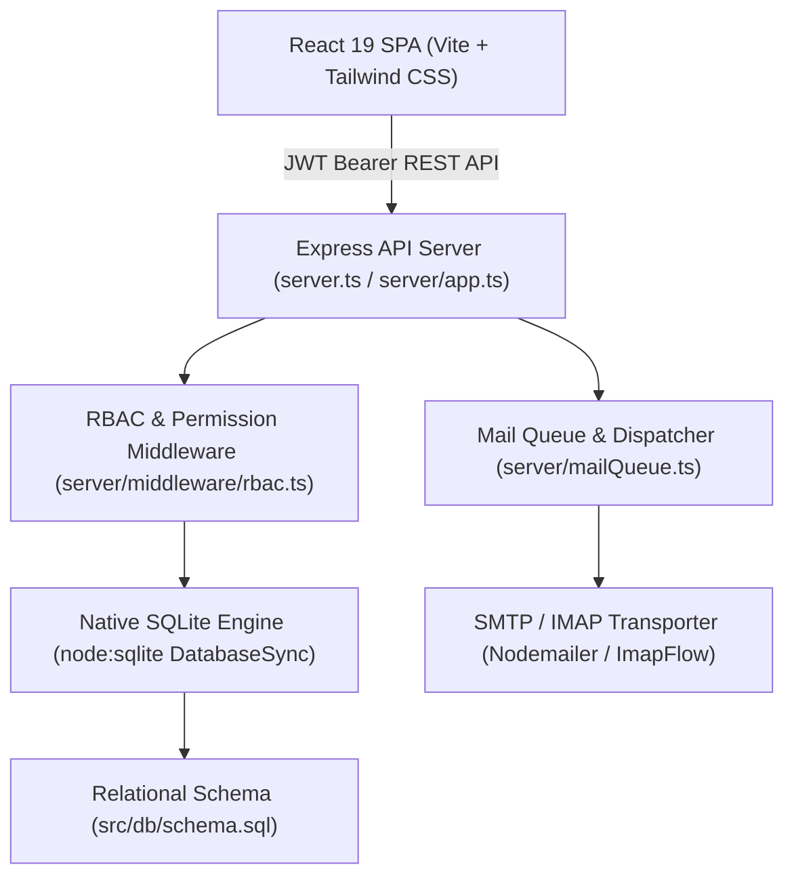

# Enterprise Asset, Attendance & Ticketing Suite

[](https://www.typescriptlang.org/)
[-green.svg)](https://nodejs.org/)
[](https://vitejs.dev/)
[](https://react.dev/)
[](https://tailwindcss.com/)
[](https://nodejs.org/api/sqlite.html)

Enterprise Employee Directory, Attendance & Leave Tracker, Indian Public Holiday Calendar, IT Asset Lifecycle & Depreciation, Work-Order Ticketing, and Automated Mail Workflow Suite.

---

## Key Modules & Capabilities

### 1. Enterprise RBAC & Security
- **Secure Authentication**: Strong password hashing via `scrypt` with random salt and timing-safe verification.
- **HMAC-SHA256 JWT**: Stateless, tamper-proof session tokens with per-token ID revocation (`jti`).
- **5 Predefined Roles & Granular Permissions**:
  - `Super Admin`: Full system access, RBAC management, DB backup/restore, audit trail.
  - `HR Manager`: Employee lifecycle, leaves & attendance management, Excel/PDF reporting.
  - `Department Manager`: Departmental attendance review, leave approvals, direct report scoping.
  - `Auditor`: Read-only compliance access to attendance logs, asset ledgers, and reports.
  - `Employee`: Self-service portal (check-in/check-out, leave requests, asset viewing, support tickets).

### 2. Employee Directory & Hierarchy
- **Strict 5-Digit Formatted IDs**: `EMP-XXXXX` validation preventing accidental duplicates or destructive overwrites.
- **KYC & Multi-Email Verification**: Dual email support (`officialEmail` and `personalEmail`) with verification flags, UAN, PAN, Voter ID, and Aadhaar card validation.
- **Manager Hierarchy & Scoping**: Direct report mapping with cycle detection and automatic leave routing.
- **Bulk CSV Import**: Import employee directories with customizable duplicate handling (`skip` or `update`).

### 3. Attendance, Leaves & Indian Holiday Rollover
- **Dynamic Check-in/Check-out**: Automatic late minute calculation (after 09:30 AM) and work hour tracking.
- **Monthly Leave Accrual**: +2 days accrued monthly (Jan–Nov), 15th-day joining cutoff, and carry-forward deduction logic.
- **Indian Centers & National Holidays**: Pre-configured Indian operational centers (Mumbai, Bengaluru, Delhi, Hyderabad, Chennai, Kolkata, Pune) with automatic annual national holiday rollover and center-level overrides.
- **Export Formats**: One-click Excel SpreadsheetML and client-side PDF attendance reporting.

### 4. IT Asset Management & Depreciation
- **Full Lifecycle**: Entry, assignment, return, departmental transfer, maintenance service logging, and salvage disposal.
- **Depreciation Engines**: Straight-Line Method (SLM) and Written-Down Value (WDV) calculation with configurable salvage value floors.
- **Batch Asset Updates**: Bulk category, department, and status reassignment with full audit log trail.

### 5. Support Ticketing & Work Order Scheduling
- **Asset-Backed Ticketing**: Strict asset ownership validation (employees can only raise tickets against actively assigned assets).
- **Conflict-Free Work Orders**: Minute-accurate slot locking with conflict detection to prevent overlapping admin work orders.
- **FCFS Queue Management**: Reorderable first-come, first-served queue with approval/rejection workflows.

### 6. Email Delivery & Admin Sender Migration
- **Branded Notification Templates**: CID-embedded corporate branding, approval call-to-actions, and one-click tokenized manager decisions.
- **Admin Sender Migration Workflow**: 6-digit OTP verification and live SMTP/IMAP loopback validation before activating new mail credentials.
- **Zero-Drop Mail Queue**: Audited queue tracking delivery statuses (`Queued`, `Sending`, `Sent`, `Failed`) with manual dispatch controls.

---

## Quick Start & Installation

### Prerequisites
- **Node.js**: `v22.5.0` or later (required for native `node:sqlite` support).
- **npm**: `v10.x` or later.

### 1. Clone & Install Dependencies
```bash
git clone <repository-url>
cd ticketassist
npm install
```

### 2. Configure Environment Variables
Copy `.env.example` to `.env` and configure your settings:
```bash
cp .env.example .env
```
Default `.env` configuration:
```env
PORT=3000
HOST=0.0.0.0
NODE_ENV=development
JWT_SECRET=assetos-enterprise-rbac-jwt-local-dev-2026

# Mail Configuration (optional for local mock testing)
MAIL_APP_NAME="AssetOS Mail"
MAIL_FROM="your-email@company.com"
MAIL_HOST="smtp.gmail.com"
MAIL_PORT="587"
MAIL_USERNAME="your-email@company.com"
MAIL_PASSWORD="your-app-password"
MAIL_ENCRYPTION="tls"
IMAP_HOST="imap.gmail.com"
IMAP_PORT="993"
```

### 3. Start Development Server
```bash
npm run dev
```
The application will boot at `http://localhost:3000` with live Vite middleware.

### 4. Build & Run for Production
```bash
# Build optimized static assets with code splitting
npm run build

# Start production server
npm start
```
## Available Scripts

| Script | Command | Description |
| :--- | :--- | :--- |
| `npm run dev` | `tsx server.ts` | Starts development server with Vite middleware |
| `npm start` | `tsx server.ts` | Starts production server serving `dist/` static files |
| `npm run build` | `vite build` | Compiles and optimizes frontend bundle with chunking |
| `npm run lint` | `tsc --noEmit` | Performs TypeScript static type checking |
| `npm test` | `tsx --test ...` | Runs all 50+ unit and server integration tests |
| `npm run test:unit` | `tsx --test src/**/*.test.ts` | Runs frontend & utility unit tests |
| `npm run test:server` | `tsx --test server/*.test.ts` | Runs SQLite RBAC, mail, and workspace tests |
| `npm run clean` | `node -e ...` | Cross-platform cleanup of `dist/` and build artifacts |

---

## Architecture & Tech Stack



---

## License & Organization
Individual & Confidential · Barun Kumar Sen
